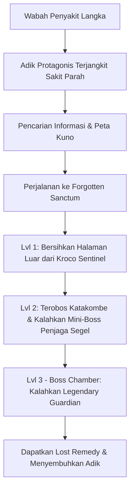

# 📜 World Building & Lore - Sestrina

## 1. Setting & Atmosfer Dunia

- **Era / Theme:** Ruined Ancient Fantasy (Sisa peradaban kuno yang tenang namun berbahaya).
- **Lokasi Utama:** *The Forgotten Sanctum of the Guardian* — Kompleks kuil kuno bertingkat tempat ditempatkannya *Lost Remedy*.
- **Atmosfer:** Sepi, melankolis, namun sarat ketegangan seiring kemajuan ke area terdalam kuil.

---

## 2. Struktur Wilayah & Tahapan Progresi

Eksplorasi tidak langsung berhadapan dengan Guardian, melainkan harus melewati tahapan rintangan dan kawanan penjaga kuno (*kroco* & mini-boss) yang melindungi area kuil:

1. **Area 1: Pelataran Terluar (Ruined Outer Courtyard)**
   - **Deskripsi:** Halaman kuil yang terbengkalai dan ditumbuhi vegetasi liar. Berfungsi sebagai area pemanasan mekanis.
   - **Ancaman (Kroco Dasar):** *Corrupted Sentinels* & *Wandering Slimes* — sisa prajurit sihir kuno yang bertindak secara naluriah menyerang penyusup.
2. **Area 2: Katakombe Terlarang (Forbidden Catacombs)**
   - **Deskripsi:** Lorong bawah tanah remang-remang yang penuh jebakan dan segel magis pelindung gerbang utama.
   - **Ancaman (Kroco Elite & Mini-Boss):** *Shadow Stalkers* (kroco lincah beracun) & *Ancient Stone Golem* (Mini-Boss Penjaga Segel Kunci Kuil).
3. **Area 3: Ruang Segel Utama / Boss Chamber (The Core Sanctum)**
   - **Deskripsi:** Ruang takhta purba yang tersegel rapi. Hanya terbuka setelah pemain mengumpulkan Segel Kunci dari Mini-Boss Catacombs.
   - **Ancaman (Final Boss):** *Legendary Guardian* (Fase 1: Guardian Form & Fase 2: Enraged Spirit Form).

---

## 3. Latar Belakang Konflik & Narasi

Dunia dilanda wabah penyakit langka tanpa penawar biasa. Protagonis menemukan catatan kuno bahwa penawar tunggal (*The Lost Remedy*) disimpan di balik gerbang kuil terlupakan yang dijaga oleh entitas pelindung (*Legendary Guardian*) beserta legiun pengawal terinfeksi (*kroco-kroco* kuil).

