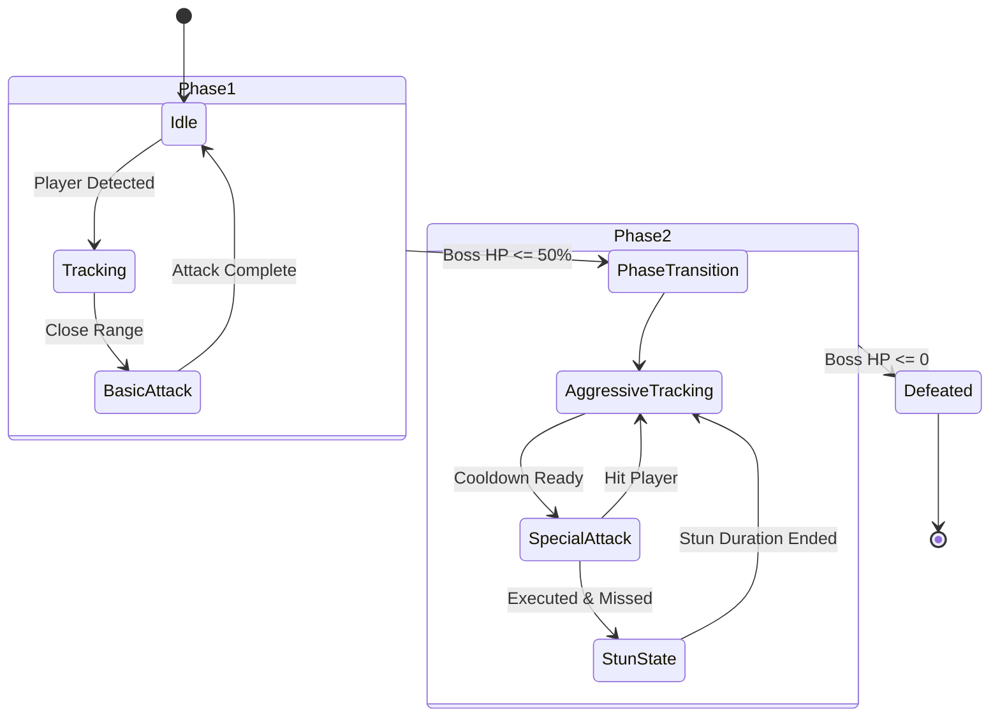

# ⚔️ Detailed Combat System - Sestrina

## 1. Struktur Boss Encounter (Single-Boss Focus)
Game ini berfokus penuh pada **Single-Boss Structure** untuk memaksimalkan *polish* dan kualitas mekanik pertarungan ketimbang menyebar resource ke banyak musuh generik.

## 2. Multi-Phase Boss System & FSM State Diagram
Boss memiliki beberapa fase bertarung yang diatur oleh **Finite State Machine (FSM)**.

## 3. Detail Mekanik FSM & Telegraphed Attack

| State Boss | Deskripsi & Logic FSM | Indikator Visual (Telegraph) |
| :--- | :--- | :--- |
| **Idle** | Menunggu input / menghitung timer jeda antar serangan. | - |
| **Tracking** | Menggunakan *Vector Steering* mendekati koordinat Pemain. | Efek jejak kaki / Aura merah samar |
| **BasicAttack** | Serangan tebasan jarak dekat (Phase 1). | Flash Kilatan Kuning (0.5s sebelum hit) |
| **SpecialAttack** | Serangan area (AOE) / Proyektil (Phase 2). | Lingkaran Merah di Tanah (1.0s sebelum hit) |
| **StunState** | Jendela rentan (3 detik) jika Special Attack meleset. | Boss Berlutut & Bintang di atas kepala |

## 4. Algoritma & Kalkulasi Damage
- **Hitbox / Hurtbox Collision:** Memanfaatkan komputasi **AABB (Axis-Aligned Bounding Box)**.
- **Formula Damage Pemain:** `DamageReceived = Base_Boss_ATK * Phase_Multiplier`
- **Formula Damage Boss:** `DamageTaken = Base_Player_ATK * (Is_Boss_Stunned ? 1.5 : 1.0)`
