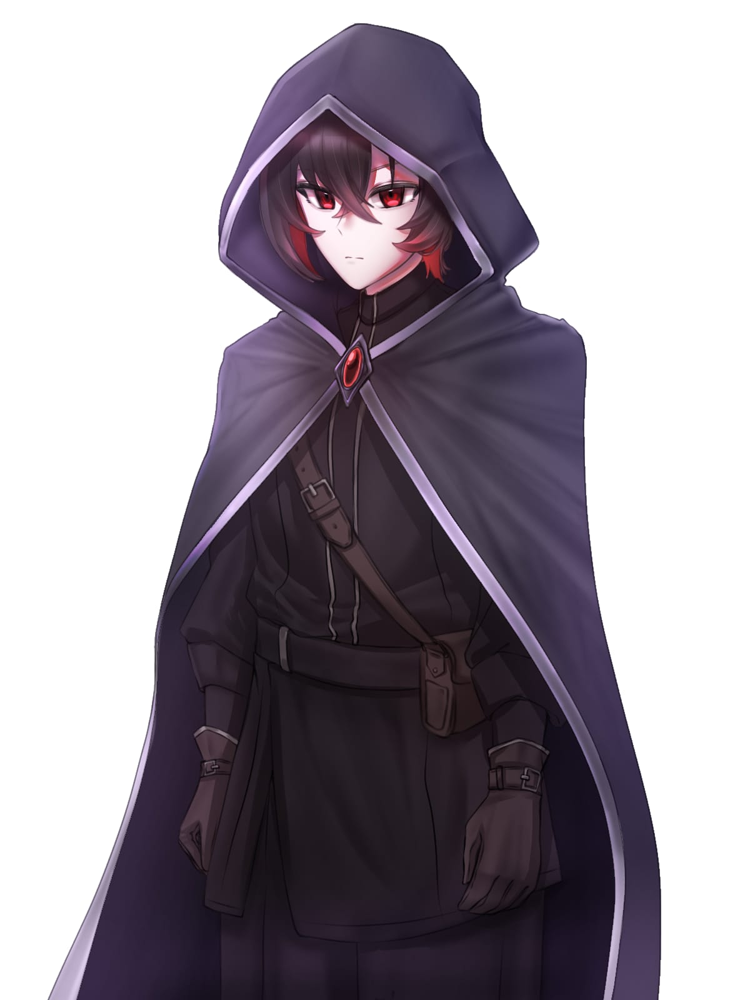
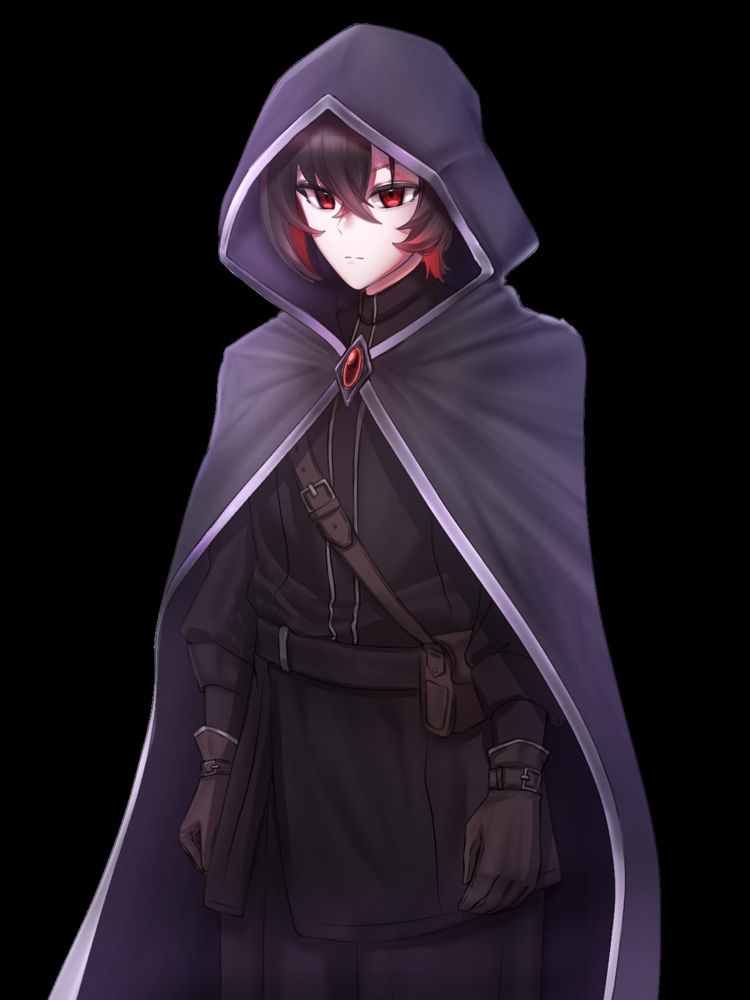
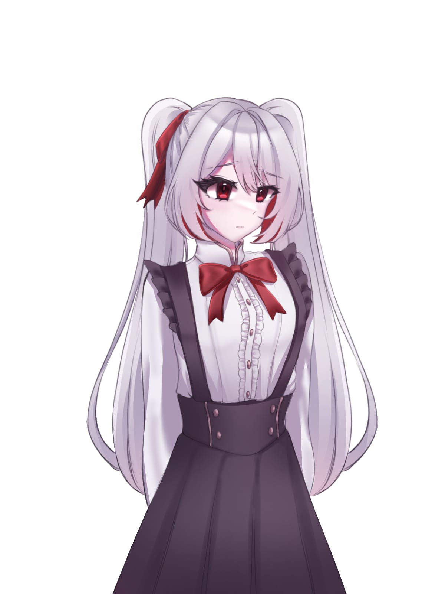
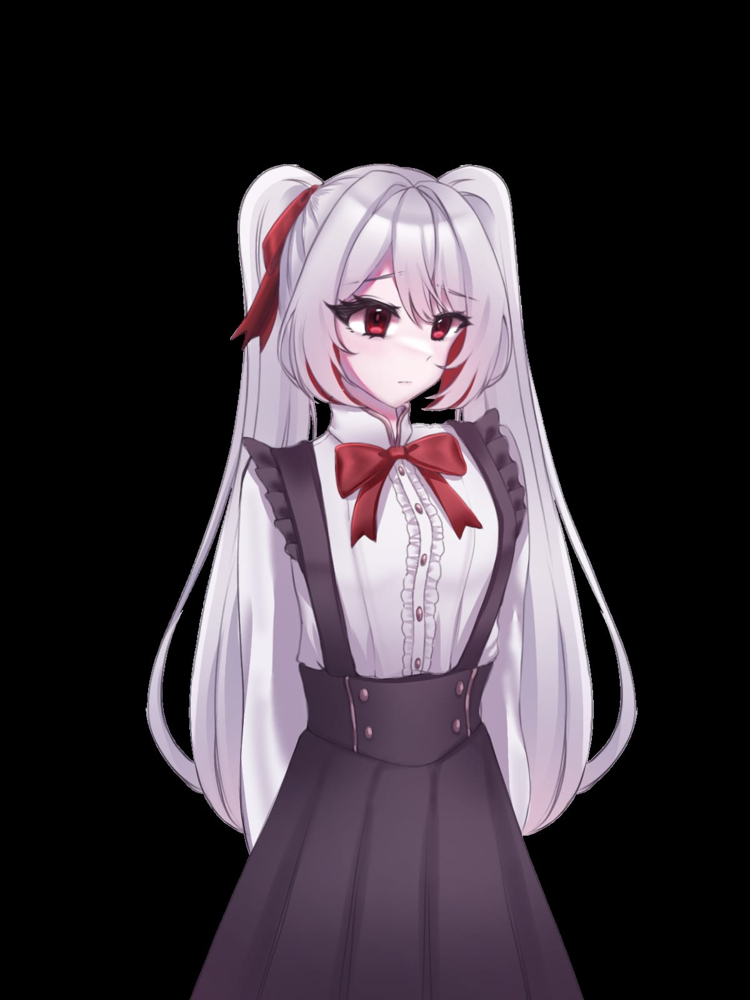
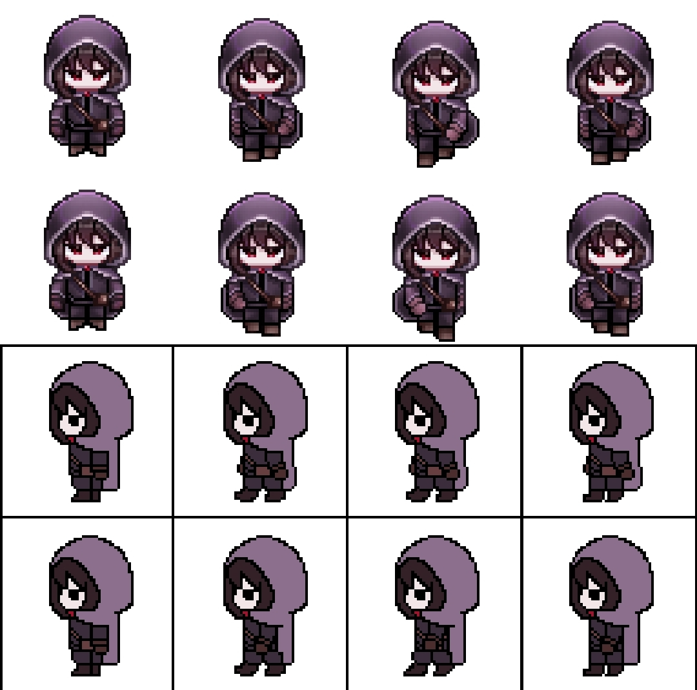

# 🎨 Checklist & Visual Asset References - Sestrina

## 1. Sumber Aset Visual (Asset Pack Credit)
- **Asset Pack Karakter:** [Character Templates Pack oleh ErisEsra (Itch.io)](https://erisesra.itch.io/character-templates-pack)
- **Asset Pack Environment / Pixel:** 2D Environment & Tileset Pack.
- **Tipe Aset:** 2D Pixel Art Character Spritesheet, Tileset & Props.
- **Tools Pengolah Aset:** Aseprite (untuk penyesuaian frame, palet warna, dan rekstrutur *hitbox/hurtbox*).

---

## 2. Aset Karakter dari `docs/04-art-assets/char/`

Berikut adalah galeri aset karakter yang tersimpan di dalam repositori proyek:

### 👤 1. Character Template Base

- **File Name:** `char_base_template.png`
- **Penggunaan:** Base sprite template untuk animasi pergerakan dasar (Idle & Walk 8-arah / 4-arah).

---

### ⚔️ 2. Character Combat & Action Frames

- **File Name:** `char_attack_anim.png`
- **Penggunaan:** Animasi aksi pertarungan (Sword Swing, Light Attack, & Heavy Attack).

---

### 🛡️ 3. Character Dodge Roll & Defense Animations

- **File Name:** `char_dodge_defense.png`
- **Penggunaan:** Frame animasi Dodge Roll / Dash (dengan invincibility frame) & Knockback / Hurt State.

---

### 👺 4. Boss / Guardian Variant Spritesheet

- **File Name:** `boss_guardian_variant.png`
- **Penggunaan:** Varian sprite karakter untuk *Legendary Guardian* (Boss Encounter) dan animasi jurus khusus.

---

## 3. Aset Environment & Pixel World dari `docs/04-art-assets/pixel/`

### 🗺️ 5. Environment & Tileset Preview

- **File Name:** `environment_tileset_preview.png`
- **Penggunaan:** Tileset dunia kuil kuno (*The Forgotten Sanctum*), dinding stone brick, vegetasi hutan, dan rintangan arena.

---

## 4. Video Pratinjau Animasi & Prototipe Gerak (`docs/04-art-assets/animation/`)

Berikut adalah pratinjau rekaman animasi pertarungan dan gerakan karakter di dalam game:

### 🎬 6. Prototipe Animasi Pertarungan Hero (`hero_combat_preview.mp4`)
<video controls width="100%" style="border-radius: 8px; margin: 12px 0; max-height: 400px; background: #0f172a;"><source src="animation/hero_combat_preview.mp4" type="video/mp4"></video>
- **File Name:** `hero_combat_preview.mp4`
- **Deskripsi:** Demonstrasi animasi pergerakan lincah, sabetan pedang (*light attack combo*), dan respon *hitbox* protagonis.

---

### 🎬 7. Prototipe Animasi Pertarungan Boss (`boss_combat_preview.mp4`)
<video controls width="100%" style="border-radius: 8px; margin: 12px 0; max-height: 400px; background: #0f172a;"><source src="animation/boss_combat_preview.mp4" type="video/mp4"></video>
- **File Name:** `boss_combat_preview.mp4`
- **Deskripsi:** Pratinjau pola serangan *telegraphed*, animasi *charge attack*, dan area dampak (AoE) dari Boss Guardian.

---

## 5. Checklist Aset Visual Utama

- [x] Protagonis Base Spritesheet (`char/char_base_template.png`)
- [x] Protagonis Attack Animations (`char/char_attack_anim.png`)
- [x] Protagonis Dodge & Hitstun (`char/char_dodge_defense.png`)
- [x] Boss Legendary Guardian Sprites (`char/boss_guardian_variant.png`)
- [x] Environment & Tileset Kuil Kuno (`pixel/environment_tileset_preview.png`)
- [x] Video Prototipe Animasi Hero (`animation/hero_combat_preview.mp4`)
- [x] Video Prototipe Animasi Boss (`animation/boss_combat_preview.mp4`)
- [ ] UI Icons (Health Bar Frame, Key Icons, Lost Remedy Item Icon)
