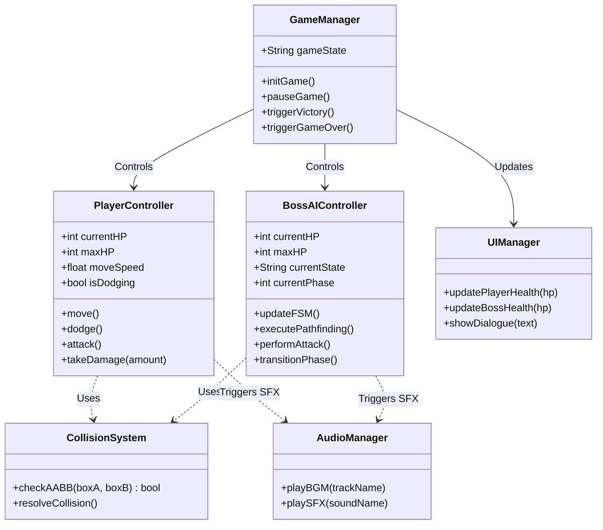
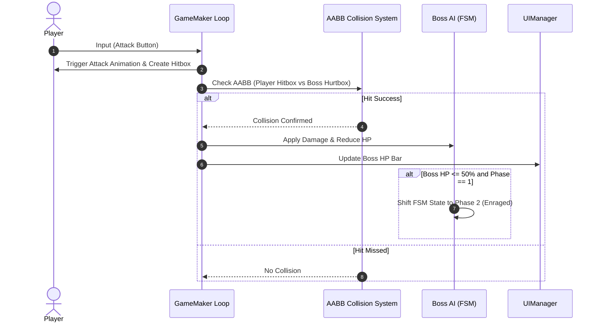

# 💻 Technical Architecture & Software Design - Sestrina

## 1. Environment & Tools Stack
- **Game Engine:** GameMaker Studio 2
- **Language:** GML (GameMaker Language)
- **Version Control:** Git / GitHub
- **Visual Design:** Aseprite (Frame-by-frame animation)

## 2. High-Level Class & Module Diagram



## 3. Implementasi Algoritma Utama (GML Logic Pseudo)

### A. Finite State Machine (FSM) Switch Logic
```gml
// Boss Create Event
state = "IDLE";
hp = 1000;
phase = 1;

// Boss Step Event
switch(state) {
    case "IDLE":
        scr_boss_idle();
        break;
    case "TRACKING":
        scr_boss_tracking();
        break;
    case "ATTACK_BASIC":
        scr_boss_attack_basic();
        break;
    case "SPECIAL_AOE":
        scr_boss_special_aoe();
        break;
    case "STUN":
        scr_boss_stunned();
        break;
}
```

### B. AABB Collision Detection Logic
```gml
/// scr_check_aabb(rect1, rect2)
var r1 = argument0;
var r2 = argument1;

return (r1.x < r2.x + r2.width &&
        r1.x + r1.width > r2.x &&
        r1.y < r2.y + r2.height &&
        r1.y + r1.height > r2.y);
```

## 4. Sequence Diagram Collision Check


