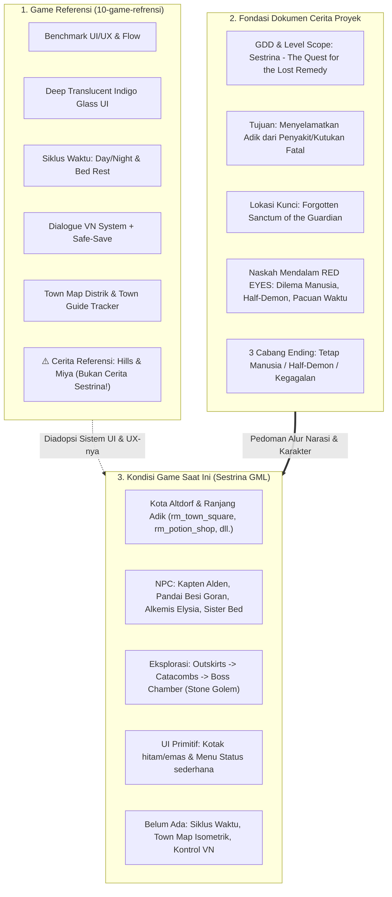

# 📊 Evaluasi Komparatif: Game Referensi vs Implementasi Sestrina vs Dokumentasi Cerita

Dokumen ini merupakan hasil audit komprehensif dan evaluasi komparatif yang menyelaraskan:
1. **Game Visual & UX Reference (Benchmark):** 24 tangkapan layar di [docs/10-game-refrensi](file:///c:/Projects/test/Sestrina/docs/10-game-refrensi) serta [image.png](file:///c:/Projects/test/Sestrina/docs/image.png) & [image copy.png](file:///c:/Projects/test/Sestrina/docs/image%20copy.png).
2. **Dokumentasi Resmi Desain & Cerita:** Dokumen [01-gdd/GDD.md](file:///c:/Projects/test/Sestrina/docs/01-gdd/GDD.md), berkas lore di [02-story-lore/](file:///c:/Projects/test/Sestrina/docs/02-story-lore/) (*world-building.md*, *characters.md*, *quests-and-dialogues.md*), serta naskah narasi mendalam [Red_Eyes_Script_Essay.pdf](file:///c:/Projects/test/Sestrina/docs/02-story-lore/Red_Eyes_Script_Essay.pdf).
3. **Kondisi Implementasi Saat Ini:** Kode program GameMaker Studio 2 (GML) di folder `objects/`, `rooms/`, dan `scripts/`.

---

## 📌 Klarifikasi Arsitektur Proyek: Memisahkan 3 Pilar Utama

Kekeliruan umum pada evaluasi awal adalah **mencampuradukkan plot cerita game referensi dengan cerita game yang sedang dikembangkan**, atau menganggap aset UI referensi sebagai cerita proyek. Untuk mencegah distorsi naratif lebih lanjut, 3 pilar ini didefinisikan secara tegas:



---

## 1. Audit & Koreksi Aspek Cerita (Story & Lore Alignment)

### A. Meluruskan Cerita yang Melenceng
1. **Pemisahan Narasi Game Referensi:**
   - Cerita pada tangkapan layar game referensi ([characterBios.png](file:///c:/Projects/test/Sestrina/docs/10-game-refrensi/characterBios.png), [choosing are.png](file:///c:/Projects/test/Sestrina/docs/10-game-refrensi/choosing%20are.png)) mengisahkan tentang **Hills** (gadis pencopet yatim piatu yang tinggal di bawah jembatan bersama Miya, Aldora, dan Charbel, beroperasi di Joy Street/slums).
   - **Koreksi:** Plot ini **hanyalah fiksi dari game pembanding**, bukan cerita Sestrina. Proyek Sestrina **tidak menggunakan** setting distrik prostitusi Joy Street atau geng pencopet Hills, melainkan mengadopsi mekanisme UI dan sistem navigasinya ke dalam dunia Sestrina / Red Eyes.

2. **Koreksi Istilah & Konteks Narasi Proyek:**
   - **Dalam Kode Saat Ini (Placeholder):** Dialog di [oNPC_Sister_Bed](file:///c:/Projects/test/Sestrina/objects/oNPC_Sister_Bed/Create_0.gml) dan [oNPC_Alden](file:///c:/Projects/test/Sestrina/objects/oNPC_Alden/Create_0.gml) menyebutkan "Bunga Cahaya Abadi" untuk menyembuhkan kutukan.
   - **Dalam Dokumen Desain Resmi ([GDD.md](file:///c:/Projects/test/Sestrina/docs/01-gdd/GDD.md), [world-building.md](file:///c:/Projects/test/Sestrina/docs/02-story-lore/world-building.md), [quests-and-dialogues.md](file:///c:/Projects/test/Sestrina/docs/02-story-lore/quests-and-dialogues.md)):** Istilah resmi adalah **"The Lost Remedy"** (Penawar Kuno yang Hilang) yang tersimpan di dalam **"The Forgotten Sanctum of the Guardian"** dan dijaga oleh **Legendary Guardian**.
   - **Dalam Naskah Narasi Mendalam ([Red_Eyes_Script_Essay.pdf](file:///c:/Projects/test/Sestrina/docs/02-story-lore/Red_Eyes_Script_Essay.pdf)):** Kondisi adik bukan sekadar sakit biasa, melainkan menderita **Overclock Mana Leak** (kebocoran mana fatal karena memaksakan sihir melebihi batas untuk melindungi protagonis saat dikhianati party petualang di dungeon). Rambut adik perlahan memutih, kondisi memburuk seiring waktu, dan protagonis berpacu dengan waktu untuk mendapatkan obat dari dungeon terdalam.

### B. Matriks Evaluasi Narasi Komparatif

| Elemen Naratif | Kondisi Game GM Saat Ini | Dokumentasi Resmi Sestrina ([GDD](file:///c:/Projects/test/Sestrina/docs/01-gdd/GDD.md) & [Story](file:///c:/Projects/test/Sestrina/docs/02-story-lore)) | Visi Naratif Mendalam ([Red_Eyes_Script_Essay.pdf](file:///c:/Projects/test/Sestrina/docs/02-story-lore/Red_Eyes_Script_Essay.pdf)) | Rencana Penyelarasan |
| :--- | :--- | :--- | :--- | :--- |
| **Premis Utama** | Protagonis mencari penawar kutukan untuk adik di ranjang desa Altdorf. | Penyakit langka melanda dunia; protagonis mencari *The Lost Remedy* di Kuil Purba *Forgotten Sanctum*. | Eksistensial & diskriminasi ras manusia; adik terluka akibat *Overclock Mana Leak* saat melindungi MC. | Pertahankan misi inti *The Lost Remedy*, namun perkuat bobot emosional dan urgensi kebocoran mana adik. |
| **Identitas Protagonis** | Petualang pedang standar di kota Altdorf. | Sang Saudara (*The Sibling*) — pejuang lincah demi ikatan persaudaraan (*familial bond*). | Pemuda 18 tahun, Rank C (sebelumnya Rank E), menyimpan trauma pengkhianatan dan rahasia *Half-Demon* (Mata Merah). | Tambahkan lapisan karakter: MC berjuang bukan sebagai ksatria terpilih, melainkan manusia biasa yang menolak menyerah. |
| **Kondisi Adik** | Sestrina terbaring di ranjang kamar tidur, statik tanpa perubahan. | Sestrina menderita sakit parah; kondisi darurat menjadi pendorong eksplorasi. | Mengungsi di gubuk pengasingan; rambut memutih perlahan, batuk, semakin banyak tidur, waktu hidup menipis. | Integrasikan perubahan dialog adik berdasarkan siklus hari (Day/Night) untuk mencerminkan kondisinya yang melemah. |
| **Karakter Pendukung** | Kapten Alden, Goran (Pandai Besi), Elysia (Apoteker). | Pandai Besi Goran, Alkemis Elysia, Penjaga Gerbang. | Blacksmith, Trader, Sang Archer (rekan petualang setia), Kucing Liar, Mystery Demon Merchant (barter personal). | Hubungkan Goran & Elysia ke sistem ekonomi referensi; tambahkan kemunculan Archer / Demon Merchant di dungeon. |
| **Struktur Musuh** | Slime di Outskirts, Skeleton di Catacombs, Golem Boss. | Kroco: *Corrupted Sentinel*, *Shadow Stalker*. Mini-Boss: *Stone Golem*. Boss: *Legendary Guardian*. | Monster habitat dungeon, Guardian penguji kelayakan, dan godaan membuka segel darah iblis. | Sesuaikan nama dan lore musuh agar sesuai dengan dokumen *Forgotten Sanctum* dan *Legendary Guardian*. |
| **Pilihan & Ending** | 1 Ending instan: Kalahkan Golem -> Berikan obat -> Tamat. | Resolusi naratif: Dapatkan *Lost Remedy* -> Kesembuhan adik. | 3 Cabang Ending: Tetap Manusia (*Human*), Meninggalkan Kemanusiaan (*Half-Demon*), atau Kegagalan (*Death*). | Tambahkan pilihan krusial di akhir pertempuran boss dan pelacak kegagalan jika waktu habis. |

---

## 2. Analisis Komparatif Fitur Visual & UI/UX (24 Aset Game Referensi)

Evaluasi berikut membedah setiap elemen sistem yang terdapat pada 24 gambar di [docs/10-game-refrensi](file:///c:/Projects/test/Sestrina/docs/10-game-refrensi) dan membandingkannya secara langsung dengan implementasi Sestrina saat ini:

```
┌────────────────────────────────────────────────────────────────────────┐
│               ANATOMI UI/UX GAME REFERENSI (10-game-refrensi)          │
├───────────────────────────────────┬────────────────────────────────────┤
│ 1. TAMPILAN SISTEM & MENU         │ 2. DUNIA & SIKLUS WAKTU            │
│ • Deep Indigo Frosted Glass       │ • Top-Left Badge: Day / Night HUD  │
│ • Double Lavender Neon Border     │ • Bed Rest: "Rest until night?"    │
│ • Main Pause Menu (11 Sub-menu)   │ • Isometrik Town Map Navigasi      │
│ • Equipment Paperdoll + Diff Stat │ • Vignette Area Preview Spotlight  │
│ • Status & Multi-Part Bios UI     │ • Town Guide (Event Tracker)       │
├───────────────────────────────────┼────────────────────────────────────┤
│ 3. DIALOG & VISUAL NOVEL HYBRID   │ 4. INTERAKSI LINGKUNGAN            │
│ • Pill Capsule Dialogue Box       │ • Story Bubble Indicator ("Story") │
│ • VN Bar: Fast, Auto, Log, Hide   │ • Glowing Interact Ring ("O")      │
│ • Standing High-Res Portraits     │ • Emotion Emote Bubbles (💧/!/...) │
│ • Safe-Save Choice: "Let me think"│ • Mission Blockade Dialogue Prompt │
└───────────────────────────────────┴────────────────────────────────────┘
```

### A. Tema, Skin Jendela, dan Palet Visual
- **Referensi Visual ([image.png](file:///c:/Projects/test/Sestrina/docs/image.png), [equipmentUI.png](file:///c:/Projects/test/Sestrina/docs/10-game-refrensi/equipmentUI.png)):**
  - Menggunakan panel **Deep Indigo / Midnight Blue Translucent** dengan efek frosted glass.
  - Garis bingkai ganda (*double neon lavender border*) dengan aksen pemotongan sudut (*corner diamond bevels*).
  - Aksen teks bersih dengan kontras tinggi (putih kebiruan untuk judul, kuning emas untuk mata uang, oranye/cyan untuk bar stat).
- **Kondisi Sestrina Saat Ini:**
  - Menggunakan kotak hitam pekat dasar dengan garis tepi emas/cokelat primitif yang digambar menggunakan fungsi bawaan `draw_roundrect_ext` atau `draw_rectangle`.
- **Kesenjangan & Solusi:**
  - Perlu pembuatan aset 9-slice sprite window skin bergaya Deep Indigo Glass agar seluruh pop-up, menu, dan dialog box memiliki estetika JRPG modern yang konsisten.

### B. Indikator Siklus Waktu (Day/Night HUD) & Mekanik Tidur
- **Referensi Visual ([importantNPCdialog.png](file:///c:/Projects/test/Sestrina/docs/10-game-refrensi/importantNPCdialog.png), [night outdoor bar.png](file:///c:/Projects/test/Sestrina/docs/10-game-refrensi/night%20outdoor%20bar.png), [rest bed option.png](file:///c:/Projects/test/Sestrina/docs/10-game-refrensi/rest%20bed%20option.png)):**
  - Di pojok kiri atas layar terdapat badge heksagonal gradien biru:
    - **Siang:** `Day 1 - Daytime` dengan ikon **Matahari Oranye Bercahaya**.
    - **Malam:** `Day 1 - Nighttime` dengan ikon **Bulan Sabit Emas**.
  - Waktu mengubah suasana lingkungan (pencahayaan malam, lampu lentera menyala di meja bar luar ruangan, aktivitas NPC berbeda).
  - Terdapat mekanisme interaksi di ranjang: saat didekati muncul cincin interaksi `[O]` dan prompt pilihan: `"Rest until night? Yes / No"`.
- **Kondisi Sestrina Saat Ini:**
  - Dunia bersifat statis tanpa pergantian waktu atau hari. Ranjang adik hanya memicu dialog tanpa fungsi memajukan waktu.
- **Kesenjangan & Solusi:**
  - Bangun sistem global `global.current_day` dan `global.day_phase` (Day/Night).
  - Buat HUD badge di kiri atas layar serta fungsikan ranjang di kamar untuk memajukan waktu, yang sekaligus memperbarui kondisi sakit adik secara bertahap.

### C. In-Game Menu / Pause Screen Terpadu (11 Sub-Menu)
- **Referensi Visual ([image.png](file:///c:/Projects/test/Sestrina/docs/image.png), [image copy.png](file:///c:/Projects/test/Sestrina/docs/image%20copy.png), [stats UI.png](file:///c:/Projects/test/Sestrina/docs/10-game-refrensi/stats%20UI.png), [questUI.png](file:///c:/Projects/test/Sestrina/docs/10-game-refrensi/questUI.png)):**
  Menu layar penuh terstruktur rapi:
  1. **Navigasi Kolom Kiri:**
     - *Item*
     - *Skills* ([image copy.png](file:///c:/Projects/test/Sestrina/docs/image%20copy.png)): Menampilkan skill aktif/pasif (`Cleave [20 TP]`, `Sticky Fingers [5 TP]`).
     - *Equipment* ([equipmentUI.png](file:///c:/Projects/test/Sestrina/docs/10-game-refrensi/equipmentUI.png)): Slot gear (*Weapons*, *Finger*, *Hands*, *Clothing*, *Accessory*) dengan komparasi delta stat (`ATK`, `DEF`, `Magic ATK`, `Magic DEF`, `SPD`, `CRI`).
     - *Status* ([stats UI.png](file:///c:/Projects/test/Sestrina/docs/10-game-refrensi/stats%20UI.png)): Ringkasan stat, EXP berikutnya, equipment aktif, dan bio ringkas karakter di panel bawah.
     - *Quests* ([questUI.png](file:///c:/Projects/test/Sestrina/docs/10-game-refrensi/questUI.png)): Pemisahan jelas antara *Main Quest* dan *Sub Quests* beserta deskripsi tugas.
     - *Character Bios* ([characterBios.png](file:///c:/Projects/test/Sestrina/docs/10-game-refrensi/characterBios.png)): Entri biografi karakter pendukung bertahap (Part 1, dst.) disertai potret standing visual novel.
     - *Town Guide* ([guide UI.png](file:///c:/Projects/test/Sestrina/docs/10-game-refrensi/guide%20UI.png)): Pelacak event kota per distrik & waktu.
     - *Options* ([option.png](file:///c:/Projects/test/Sestrina/docs/10-game-refrensi/option.png)): Pengaturan BGM, SFX, dan preferensi tampilan.
     - *Save* ([save UI.png](file:///c:/Projects/test/Sestrina/docs/10-game-refrensi/save%20UI.png)): 10 slot save dengan thumbnail, level, lokasi, waktu bermain, dan hari.
     - *Load*: Membuka layar pemuatan data.
     - *Exit* ([exit option.png](file:///c:/Projects/test/Sestrina/docs/10-game-refrensi/exit%20option.png)): Konfirmasi keluar ke Title Screen atau Desktop.
  2. **Badge Mata Uang Kiri Bawah:** Kotak terpisah menunjukkan `500 G`.
  3. **Kartu Profil Kanan Atas:** Avatar, nama karakter, Level, HP Bar (oranye), MP Bar (cyan), TP Bar (abu-abu).
- **Kondisi Sestrina Saat Ini:**
  - Hanya memiliki shortcut `[P]` untuk modal kecil alokasi 4 atribut (VIT, STR, INT, AGI) dan HUD bawah untuk belanja di toko secara terpisah.
- **Kesenjangan & Solusi:**
  - Satukan sistem menu ke dalam Pause Menu terpusat dengan layout 2-kolom seperti referensi.

### D. Sistem Presentasi Dialog & Fitur Visual Novel
- **Referensi Visual ([importantNPCdialog.png](file:///c:/Projects/test/Sestrina/docs/10-game-refrensi/importantNPCdialog.png), [importantNPCdialog2.png](file:///c:/Projects/test/Sestrina/docs/10-game-refrensi/importantNPCdialog2.png), [NOTimportantNPCdialog.png.png](file:///c:/Projects/test/Sestrina/docs/10-game-refrensi/NOTimportantNPCdialog.png.png), [optional choosing story.png](file:///c:/Projects/test/Sestrina/docs/10-game-refrensi/optional%20choosing%20story.png)):**
  - **Bentuk Kotak Dialog:** Kotak semi-transparan berbentuk kapsul melengkung (*curved pill shape*) dengan nameplate terpisah di kiri atas.
  - **Diferensiasi NPC Penting vs Warga:**
    - *NPC Penting:* Menampilkan ilustrasi *standing character portrait* beresolusi tinggi di sisi kiri dan kanan (dapat menampilkan hingga 3 karakter sekaligus dalam satu adegan).
    - *NPC Biasa (Warga/Orang Lewat):* Hanya memunculkan nama (misal: "Man in Gray") dan potret protagonis di kanan tanpa potret NPC.
  - **Bilah Kontrol Visual Novel (Pojok Kanan Kotak):**
    - `⏩` *Fast Forward / Skip*
    - `▶` *Auto-advance*
    - `≡` *Message Log / Backlog*
    - `✖` *Hide UI*
  - **Pilihan Bercabang & Fitur Safe-Save:**
    - Tombol pilihan berupa bilah kapsul berujung berlian horizontal.
    - Opsi ramah pemain **"Let me think"** yang otomatis membuka layar Save sebelum pemain menentukan keputusan kritis.
- **Kondisi Sestrina Saat Ini:**
  - Dialog box berupa persegi panjang sederhana dengan avatar kecil, teks bertahap, dan penekanan tombol `[Space]` untuk lanjut, tanpa kontrol VN maupun opsi safe-save.
- **Kesenjangan & Solusi:**
  - Perbarui renderer dialog box agar memiliki kontrol VN (Skip, Auto, Log, Hide) dan tambahkan opsi "Let me think" pada setiap cabang keputusan penting.

### E. Navigasi Dunia & Town Map Isometrik
- **Referensi Visual ([map.png](file:///c:/Projects/test/Sestrina/docs/10-game-refrensi/map.png), [choosing are.png](file:///c:/Projects/test/Sestrina/docs/10-game-refrensi/choosing%20are.png), [leaving area option.png](file:///c:/Projects/test/Sestrina/docs/10-game-refrensi/leaving%20area%20option.png)):**
  - Peta kota bergaya ilustrasi isometrik dengan pin lokasi wilayah.
  - Chibi sprite yang menandai posisi karakter saat ini di peta.
  - Saat mengarahkan kursor ke salah satu lokasi: Muncul **circular vignette spotlight** yang menampilkan preview interior lokasi, ringkasan lore wilayah, dan prompt pilihan konfirmasi: `Enter / Don't enter`.
  - Saat mencapai perbatasan wilayah, muncul prompt konfirmasi keluar: `Leave [Area]? Leave / Don't leave`.
  - Terdapat shortcut tombol **Town Guide** dengan badge notifikasi tanda seru merah `(!)` di pojok kanan bawah peta.
- **Kondisi Sestrina Saat Ini:**
  - Transisi antar area dilakukan secara linier dengan menyentuh objek pintu (`oDoor_*`) yang memindahkan pemain antar room (`rm_town_square`, `rm_outskirts`, `rm_catacombs`, `rm_boss_chamber`).
- **Kesenjangan & Solusi:**
  - Tambahkan sistem World Map / District Map untuk menghubungkan area utama (Kamar Adik/Gubuk Pengasingan, Altdorf Square, Bengkel Goran, Apotek Elysia, Gerbang Hutan/Outskirts, dan Kuil Kuno).

### F. Town Guide System (Event & Quest Tracker)
- **Referensi Visual ([guide UI.png](file:///c:/Projects/test/Sestrina/docs/10-game-refrensi/guide%20UI.png)):**
  - Layar katalog interaktif yang merinci event yang tersedia di tiap distrik kota.
  - Penanda status event:
    - `?` Biru: Event yang belum ditemukan/dipicu.
    - `!` Merah: Event / quest utama yang siap dijalankan.
  - Menampilkan pratinjau lokasi dalam bentuk lingkaran spotlight, petunjuk event, serta waktu pelaksanaan (`Time: Daytime / Nighttime`).
- **Kondisi Sestrina Saat Ini:**
  - Informasi quest hanya ditampilkan dalam bentuk string teks sederhana di sudut layar (`scr_set_quest`).
- **Kesenjangan & Solusi:**
  - Bangun menu Town Guide / Quest Log yang melacak ketersediaan event berdasarkan waktu (Siang/Malam) dan status penyelesaian.

### G. Interaksi Lingkungan, Story Bubbles, dan Emote Reaksi
- **Referensi Visual ([story bubble indikator.png](file:///c:/Projects/test/Sestrina/docs/10-game-refrensi/story%20bubble%20indikator.png), [rest bed option.png](file:///c:/Projects/test/Sestrina/docs/10-game-refrensi/rest%20bed%20option.png), [reactionbubble.png](file:///c:/Projects/test/Sestrina/docs/10-game-refrensi/reactionbubble.png), [can't get in building.png](file:///c:/Projects/test/Sestrina/docs/10-game-refrensi/can't%20get%20in%20building.png)):**
  - **Story Bubble Indicator:** Balon dialog melayang di atas kepala NPC bertuliskan `Story` atau `Events` untuk membedakan NPC alur utama dari NPC biasa.
  - **Interact Ring:** Cincin lingkaran bercahaya (`O`) di atas objek interaktif (ranjang istirahat, papan nama, meja resepsionis).
  - **Emotion Emote Bubbles:** Balon reaksi emosional di atas kepala karakter saat berbicara (tetesan keringat `💧`, tanda seru `!`, tanda tanya `?`, titik-titik `...`).
  - **Mission Blockade Prompt:** Saat mencoba memasuki gedung atau area yang belum relevan dengan misi saat ini, muncul standing portrait karakter dengan monolog internal: *"Right now I'm on a mission. This isn't the time to go wandering around."*
- **Kondisi Sestrina Saat Ini:**
  - Menggunakan teks prompt mengambang standar `[E] Bicara` yang di-render manual melalui fungsi draw text.
- **Kesenjangan & Solusi:**
  - Tambahkan komponen penanda visual di atas kepala karakter (balon `Story`, emote reaksi emosi, dan cincin interaksi `[O]`).

---

## 3. Matriks Komparasi Menyeluruh: Referensi vs Sestrina Saat Ini vs Visi Desain

```
┌────────────────────────────────────────────────────────────────────────────────────────────────────────┐
│                                TABEL MATRIKS SISTEM & FITUR KOMPARATIF                                │
├──────────────────────────┬──────────────────────────┬──────────────────────────┬───────────────────────┤
│ Fitur / Komponen         │ Game Referensi           │ Sestrina Saat Ini        │ Visi Dokumen Desain   │
├──────────────────────────┼──────────────────────────┼──────────────────────────┼───────────────────────┤
│ Window Theme             │ Deep Translucent Indigo  │ Rectangles Hitam / Emas  │ Deep Frosted Glass UI │
│ Siklus Waktu             │ Day/Night HUD + Bed Rest │ Statis (Tanpa Waktu)     │ Day/Night Urgency     │
│ Pause Menu               │ 11 Sub-menu Terintegrasi │ Modal [P] Sederhana      │ Menu Terpadu JRPG     │
│ Dialogue System          │ Pill Box + VN Controls   │ Kotak Standar + [Space]  │ VN Hybrid + Safe-Save │
│ Standing Character Art   │ Multi-Portraits Kiri-Kanan│ Avatar Kecil Saja        │ Standing Art Portrait │
│ World Navigation         │ Isometrik Map + Spotlight│ Pintu Room Konvensional │ Isometrik / Node Map  │
│ Event Tracker            │ Town Guide (Siang/Malam) │ Baris Teks Quest Tunggal │ Town Guide & Journal  │
│ Indikator Interaksi      │ Balon Story & Ring [O]   │ Prompt Teks [E] Biasa    │ Story Bubble & Emotes │
│ Safe-Save Feature        │ Opsi "Let me think"      │ Tidak Tersedia           │ Safe-Save saat Cabang │
│ Sistem Ending            │ Beragam (Berdasarkan Quest)│ 1 Ending Selesai         │ 3 Cabang Ending       │
└──────────────────────────┴──────────────────────────┴──────────────────────────┴───────────────────────┘
```

---

## 4. Actionable Roadmap Penyelarasan (Rencana Aksi Bertahap)

Berikut adalah rencana langkah demi langkah untuk menyerap keunggulan sistem UI/UX game referensi ke dalam dunia dan alur cerita Sestrina yang sesungguhnya:

```mermaid
graph TD
    subgraph Phase1 ["Fase 1: Penyelarasan Cerita & Sistem Waktu"]
        P1A["Koreksi Naskah: 'The Lost Remedy' & Kebocoran Mana Adik"]
        P1B["Implementasi Day/Night Cycle (Daytime / Nighttime)"]
        P1C["Fungsikan Ranjang untuk Memajukan Waktu (Bed Rest)"]
        P1D["Variasi Kondisi Sakit Adik Seiring Berjalannya Hari"]
    end

    subgraph Phase2 ["Fase 2: Redesign UI & Window Skin JRPG"]
        P2A["Aset 9-Slice Deep Translucent Indigo dengan Lavender Glow"]
        P2B["Day/Night HUD Badge di Pojok Kiri Atas Layar"]
        P2C["Pill Capsule Dialogue Box + Kontrol VN (Skip, Auto, Log, Hide)"]
        P2D["Fitur Safe-Save 'Let me think' pada Pilihan Dialog Kritis"]
    end

    subgraph Phase3 ["Fase 3: Menu Pause Terpadu & Pelacak Quest"]
        P3A["Restrukturisasi Menu [P] Menjadi 11 Sub-Menu Terintegrasi"]
        P3B["Kartu Profil Karakter (HP, MP, TP, Lv, Avatar)"]
        P3C["Layar Quests & Town Guide (Pemisah Main/Sub Quest)"]
        P3D["Layar Save/Load Multi-Slot dengan Metadata Lengkap"]
    end

    subgraph Phase4 ["Fase 4: Eksplorasi Dunia & Interaksi Visual"]
        P4A["Peta Pemilihan Area Isometrik dengan Spotlight Vignette"]
        P4B["Balon 'Story' / 'Events' di Atas Kepala NPC Penting"]
        P4C["Cincin Interaksi 'O' pada Objek Lingkungan"]
        P4D["Emotion Emote Bubbles (💧 / ! / ? / ...) Saat Dialog"]
        P4E["Implementasi 3 Cabang Ending (Human / Half-Demon / Failure)"]
    end

    Phase1 --> Phase2
    Phase2 --> Phase3
    Phase3 --> Phase4
```



### Prioritas 1: Penyelarasan Cerita & Sistem Waktu
1. **Luruskan Naskah Cerita:**
   - Ganti teks dialog "Bunga Cahaya Abadi" dengan istilah resmi **The Lost Remedy**.
   - Masukkan konteks bahwa adik terluka akibat *Overclock Mana Leak* saat melindunginya di dungeon masa lalu.
   - Buat protagonis bersikap lebih reflektif dan waspada (memperlihatkan luka batin pengkhianatan party terdahulu).
2. **Siklus Day/Night & Urgensi Waktu:**
   - Tambahkan variabel global pelacak hari (`global.day_count`) dan siklus (`global.time_of_day: "Daytime" | "Nighttime"`).
   - Fungsikan ranjang di kamar adik untuk tidur dan memajukan waktu (`"Rest until night? Yes / No"`).
   - Dialog dan kondisi adik berubah seiring hari bertambah (makin batuk dan banyak tidur jika pemain terlalu lama menunda misi).

### Prioritas 2: Rombak Visual Antarmuka (JRPG Frosted Glass UI)
1. **Window Skin:** Buat sprite panel semi-transparan indigo dengan border ganda lavender neon dan bevel sudut permata.
2. **Day/Night Badge HUD:** Gambar badge heksagonal di pojok kiri atas dengan ikon matahari saat siang dan bulan sabit saat malam.
3. **Penyempurnaan Kotak Dialog:**
   - Ubah bentuk dialog box menjadi *curved pill style*.
   - Tambahkan 4 tombol kontrol VN di pojok kanan atas dialog: Skip (`⏩`), Auto (`▶`), Log (`≡`), dan Hide (`✖`).
   - Terapkan opsi keputusan ramah pemain: *"Let me think"* yang otomatis memicu layar simpan sebelum mengambil keputusan berisiko tinggi.

### Prioritas 3: Menu Pause Terpadu & Town Guide Tracker
1. **Main Pause Screen:**
   - Satukan navigasi Item, Skills, Equipment, Status, Quests, Character Bios, Town Guide, Options, Save, Load, Exit ke dalam satu layar terstruktur 2-kolom.
   - Tampilkan kartu mini karakter di pojok kanan atas (Avatar, Level, Bar HP, Bar MP, Bar TP).
2. **Town Guide & Quest Tracker:**
   - Bangun tracker yang mencatat event apa saja yang tersedia di setiap distrik pada waktu Siang vs Malam dengan indikator status (`?` Biru dan `!` Merah).

### Prioritas 4: Interaksi Lingkungan & Sistem Ending
1. **Indikator Dunia:**
   - Render cincin bercahaya (`O`) pada objek ranjang, pintu, dan nodus penting.
   - Pasang balon `Story` di atas NPC yang sedang memegang kelanjutan alur quest.
   - Tambahkan emote animasi (keringat `💧`, seru `!`, tanda tanya `?`) di atas kepala sprite saat adegan dialog berlangsung.
2. **Multi-Ending Sestrina:**
   - **Ending 1 (Tetap Manusia / Human):** Berhasil membawa *The Lost Remedy* tepat waktu dengan kekuatan sendiri. Adik sembuh sepenuhnya.
   - **Ending 2 (Meninggalkan Kemanusiaan / Half-Demon):** Membuka segel darah iblis di ruang boss demi kekuatan mutlak. Adik terselamatkan namun protagonis bertransformasi wujud.
   - **Ending 3 (Kegagalan / Death):** Kehabisan waktu (hari melebihi batas sebelum boss dikalahkan). Protagonis kembali dan mendapati adik telah tiada.

---

## Kesimpulan Evaluasi

Game Sestrina saat ini telah memiliki **fondasi mekanik aksi yang solid** (sistem pertarungan real-time, tebasan kombo, nodus tambang, toko senjata & ramuan, serta arena boss bertingkat). Namun, game ini masih memiliki dua aspek utama yang perlu disempurnakan:

1. **Kedalaman Narasi:** Naskah dialog di dalam game perlu diselaraskan dengan dokumen resmi [GDD.md](file:///c:/Projects/test/Sestrina/docs/01-gdd/GDD.md) dan naskah mendalam [Red_Eyes_Script_Essay.pdf](file:///c:/Projects/test/Sestrina/docs/02-story-lore/Red_Eyes_Script_Essay.pdf), menyingkirkan distorsi cerita fiktif game referensi (Hills/Miya), serta memperkuat taruhan emosional kebocoran mana adik dan dilema kemanusiaan.
2. **Presentasi UI/UX Modern:** Mengadopsi arsitektur visual elegan dari **game referensi** — yaitu window skin *Deep Indigo Glass*, indikator waktu *Day/Night HUD*, kotak dialog bergaya Visual Novel dengan kontrol interaktif, fitur *Safe-Save ("Let me think")*, navigasi *Town Map Isometrik*, serta indikator dunia (*Story Bubbles* & *Interact Rings*).

Dengan menyelaraskan kedua aspek ini, Sestrina akan bertransformasi dari sekadar prototipe tempur menjadi **Action RPG naratif berkualitas tinggi** yang memukau secara visual dan menggugah secara emosional.
