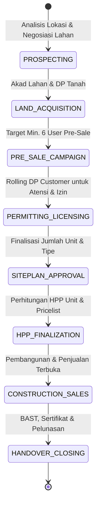

# 01. Product Requirement Document (PRD) & Business Process
## Sistem Manajemen Proyek Perumahan Multi-Proyek & Cashflow Feasibility

### 1. Ringkasan Eksekutif & Problem Statement
Dalam model bisnis pengembang perumahan skala kecil hingga menengah (*landed housing developer*), risiko kegagalan terbesar bukan terletak pada konstruksi fisik bangunan, melainkan pada **ketidakcocokan arus kas (*cashflow mismatch*)** antara:
1. **Kewajiban Pembayaran Lahan**: Skema pembayaran bertahap (termin) ke pemilik tanah yang memiliki batas waktu dan risiko sengketa/gagal bayar.
2. **Realisasi Uang Masuk Pre-Sale**: Pengumpulan uang muka (*Down Payment* / DP) dari konsumen awal yang dicicil bertahap.
3. **Pengeluaran Unkondisional Pra-Proyek**: Pengeluaran biaya sosial (koordinasi warga, RT/RW, tokoh masyarakat) serta biaya legalitas/atensi perizinan (OSS, UKL-UPL, izin siteplan).

Menentukan Harga Pokok Penjualan (HPP) dan Harga Jual rumah **tidak dapat dilakukan di awal secara statis**, melainkan harus melalui proses pematangan lahan (*land development*) dan validasi siteplan agar seluruh biaya tak terduga (*hidden cost*) dapat dialokasikan secara proporsional ke setiap unit.

Sistem ini dirancang untuk:
- Mengisolasi buku kas per proyek (*Project-based Ledger* / Multi-tenant Project).
- Mencegah *cashflow bleed* (pengeluaran bengkak tanpa kontrol).
- Memberikan simulasi skenario (*Best Case* vs *Worst Case*).
- Menghitung HPP dinamis dan batas harga negosiasi unit.

---

### 2. Siklus Hidup Proyek (Project Lifecycle State Machine)



#### Tahapan Rinci:
1. **Phase 1: Land Acquisition (Pembebasan Lahan)**
   - Negosiasi harga tanah mentah (contoh basis: Rp 1.000.000.000,-).
   - Pengikatan DP awal tanah (contoh basis: Rp 25.000.000,-).
   - Penjadwalan termin pelunasan tanah (standar 12 bulan; worst case 6 bulan; pembayaran per 4 bulan: 30%, 30%, 40%).
2. **Phase 2: Pre-Sale Campaign & Rolling Fund**
   - Menjual komitmen awal sebelum konstruksi (target minimal 6 konsumen pre-sale).
   - Skema pembayaran DP user: Rp 50.000.000,- dicicil 3 bulan (~Rp 16.670.000/bln).
   - Total proyeksi modal kerja awal terkumpul = Rp 300.000.000,-.
3. **Phase 3: Unconditional & Permitting Allocation**
   - Pengeluaran sosial/kegiatan warga: Rp 5 - 7 Jt/rapat (kasus buruk 3x rapat = Rp 15 - 20 Jt).
   - Pembayaran sesi tanah tahap awal: Rp 25 Jt.
   - Pos dana atensi perizinan: Rp 260 Jt (OSS, UKL-UPL, Pengesahan Siteplan).
4. **Phase 4: Siteplan & Unit Allocation**
   - Menghitung *Sellable Area* (luas efektif kavling setelah dikurangi fasilitas umum/fasum jalan, saluran air, RTH).
   - Penetapan jumlah kavling dan tipe bangunan (misal: Tipe 36, Tipe 45, Tipe 54).
5. **Phase 5: Financial Engine (HPP & Pricing)**
   - Alokasi biaya tanah matang + biaya konstruksi + alokasi beban operasional & atensi.
   - Penetapan margin profit pengembang (20% - 30%).
   - Pembentukan struktur komisi marketing (2.5% total: 2% freelance + 0.5% in-house coordinator).
   - Penentuan *Negotiation Bottom Price* (harga terendah yang diizinkan untuk negosiasi).

---

### 3. Business Rules & Early Warning System (EWS)

#### Rule 1: Cashflow Ring-Fencing (Isolasi Kas Antar Proyek)
- Kas yang masuk dari DP konsumen Proyek A dilarang keras dipinjamkan atau digunakan untuk menalangi Proyek B tanpa persetujuan *Intercompany Loan Transaction*.
- Setiap transaksi pengeluaran wajib memiliki *Cost Center Tag*.

#### Rule 2: Land Default Early Warning System (EWS)
Sistem memantau proyeksi saldo kas 60 hari ke depan (*30-60 Days Forward Cash Forecast*):
- **Status HIJAU**: Proyeksi saldo kas proyek $\ge$ 120% dari nilai jatuh tempo termin tanah berikutnya.
- **Status KUNING**: Proyeksi saldo kas antara 100% - 119% (Perlu percepatan penagihan cicilan DP customer).
- **Status MERAH (CRITICAL ALERT)**: Proyeksi saldo kas $< 100\%$ nilai jatuh tempo tanah. Sistem mengunci pengeluaran non-esensial dan mengeluarkan rekomendasi:
  - Opsi A: Restrukturisasi jadwal pembayaran ke pemilik tanah.
  - Opsi B: Tambah kuota pre-sale dengan diskon kas keras terbatas.
  - Opsi C: Injeksi talangan modal kerja owner.

#### Rule 3: Dynamic Price Protection & Negotiation Guard
- Staf marketing hanya dapat memberikan diskon hingga batas `Max_Discount_Amount`.
- Jika negosiasi pembeli menembus batas `Bottom_Price` (mengorbankan margin di bawah threshold 15%), sistem mewajibkan *Owner Override Approval* secara berjenjang.

---

### 4. Alokasi Dana DP Pre-Sale (Ring-Fenced Cash Flow)

```
Total Dana Masuk Pre-Sale (6 User x Rp 50 Jt) = Rp 300.000.000
│
├── [1] Biaya Kegiatan / Pra-Proyek (Warga & Tokoh) 
│       Estimasi Best Case : Rp  7.000.000  (2.33%)
│       Estimasi Worst Case: Rp 15.000.000 - 20.000.000 (5 - 6.67%)
│
├── [2] Pembayaran Lahan Sesi Awal
│       Komitmen Pembayaran: Rp 25.000.000
│
└── [3] Sisa Cadangan Kas Proyek (Pos Atensi & Perizinan)
        Best Case  : Rp 300 Jt - Rp 7 Jt  - Rp 25 Jt = Rp 268.000.000
        Worst Case : Rp 300 Jt - Rp 20 Jt - Rp 25 Jt = Rp 255.000.000 - Rp 260.000.000
        Dialokasikan untuk:
        - OSS & PKKPR
        - UKL / UPL Lingkungan Hidup
        - Gambar Teknik & Pengesahan Siteplan Pemda
        - Operasional Rutin Tim Lapangan (3-4 bulan pertama)
```
