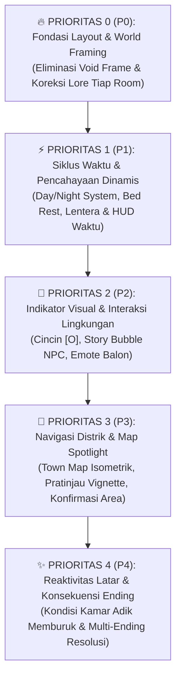

# 🗺️ Roadmap & Checklist Penyelarasan Latar & Lingkungan
**Proyek:** Sestrina: The Quest for the Lost Remedy  
**Tujuan:** Menyelaraskan setting latar (background, layout, pencahayaan, navigasi, dan atmosfer dunia) GameMaker Studio dengan **Game Referensi** ([docs/10-game-refrensi/](file:///c:/Projects/test/Sestrina/docs/10-game-refrensi/)) dan **Dokumen Resmi Narasi/GDD** ([01-gdd/GDD.md](file:///c:/Projects/test/Sestrina/docs/01-gdd/GDD.md), [02-story-lore/world-building.md](file:///c:/Projects/test/Sestrina/docs/02-story-lore/world-building.md), [Red_Eyes_Script_Essay.pdf](file:///c:/Projects/test/Sestrina/docs/02-story-lore/Red_Eyes_Script_Essay.pdf)).

---

## 📊 Matriks Skala Prioritas Eksekusi

---

## 🔥 Prioritas 0 (P0): Fondasi Layout & World Framing (Eliminasi Void Frame)
> **Tujuan:** Menghilangkan tampilan kotak sempit 400px yang dikelilingi kehampaan hitam (*void frame*), memperluas latar ke seluruh viewport 1280x720, dan menyelaraskan tema ruangan dengan dokumen narasi resmi.

### 📋 Checklist P0
- [x] **P0.1: Koreksi Latar Rumah Lengkap Sestrina ([Room1](file:///c:/Projects/test/Sestrina/rooms/Room1/Room1.yy) / [oBedroomDecor](file:///c:/Projects/test/Sestrina/objects/oBedroomDecor/Draw_0.gml))**
  - [x] Dimensi diperluas ke **1920x1080** dengan Dynamic Camera Tracking (`lerp 0.15`).
  - [x] **Integrasi Aset Pixel Art Nyata (`asset-packs`):**
    * Dapur masak & kompor batu otentik dari `sStation_Cooking` (Pixel Crawler).
    * Tumpukan kayu bakar, tong logistik & pot tanaman dari `sProp_OutdoorDecor` (Cute Fantasy).
    * Pohon pinus rimbun luar jendela dari `sProp_Trees_Pine` dan pohon oak dari `sProp_OakTree`.
    * Rak bumbu, peti senjata tempur (`sTreasureChest`), botol herbal penenang adik dari `sFurnishings`.
    * Layout 2 sayap: Sayap Kiri (Ruang Tamu & Dapur) + Sayap Kanan (Kamar Pribadi Sestrina) dipisahkan dinding kayu bergapura.
- [x] **P0.2: Perluas Alun-Alun Kota Altdorf Menjadi Multi-Bangunan Sprawling ([rm_town_square](file:///c:/Projects/test/Sestrina/rooms/rm_town_square/rm_town_square.yy) / [oDecorTown](file:///c:/Projects/test/Sestrina/objects/oDecorTown/Draw_0.gml))**
  - [x] Dimensi kota diperluas ke **2560x1440** mencakup 14 bangunan/fasilitas.
  - [x] **Integrasi Aset Pixel Art Nyata (`asset-packs`):**
    * Rumah-rumah warga menggunakan `sProp_HouseBlue` (Cute Fantasy) dengan atap biru pixel art estetik.
    * Bengkel Goran dilengkapi tungku tempa nyata `sStation_Furnace` dan landasan anvil `sStation_Anvil` (Pixel Crawler).
    * Apotek Elysia dilengkapi stasiun alkimia bertingkat `sStation_Alchemy` dan pot herbal.
    * Kebun Botani Kota dipagari kayu pixel art `sProp_Fences` dengan petak bunga `sProp_OutdoorDecor`.
    * Bazaar Pasar Barat dilengkapi kotak buah segar & keranjang panen nyata dari `sProp_OutdoorDecor`.
    * Lentera jalanan menggunakan sprite lentera tiang `sProp_OutdoorDecor` dengan pendaran cahaya malam.
    * Pepohonan kota menggunakan `sProp_OakTree`.
- [x] **P0.3: Perluas Interior Toko Pandai Besi & Apotek ([rm_weapon_shop](file:///c:/Projects/test/Sestrina/rooms/rm_weapon_shop/rm_weapon_shop.yy) & [rm_potion_shop](file:///c:/Projects/test/Sestrina/rooms/rm_potion_shop/rm_potion_shop.yy))**
  - [x] Bengkel Goran (`oDecorWeaponShop`): Tungku bara `sStation_Furnace`, anvil `sStation_Anvil`, tong air & kayu bakar.
  - [x] Apotek Elysia (`oDecorPotionShop`): Stasiun alkimia `sStation_Alchemy`, rak buku grimoire, pot tanaman obat.
- [x] **P0.4: Penyelarasan Latar Dungeon Kuil Purba ([rm_outskirts](file:///c:/Projects/test/Sestrina/rooms/rm_outskirts/rm_outskirts.yy), [rm_catacombs](file:///c:/Projects/test/Sestrina/rooms/rm_catacombs/rm_catacombs.yy), [rm_boss_chamber](file:///c:/Projects/test/Sestrina/rooms/rm_boss_chamber/rm_boss_chamber.yy))**
  - [x] Pilar-pilar purba dan sarkofagus katakombe menggunakan `sDungeon_Props` (Pixel Crawler).
  - [x] Pohon pinus dan oak rimbun di pelataran kuil kuno `rm_outskirts`.
  - [x] Altar **The Lost Remedy** di ruang takhta purba **The Forgotten Sanctum**.

---

## ⚡ Prioritas 1 (P1): Siklus Waktu & Pencahayaan Dinamis (Day/Night Ambience)
> **Tujuan:** Menghadirkan atmosfer waktu siang/malam yang mengubah visual latar, lampu lentera, dan mekanisme ranjang tidur untuk menciptakan urgensi pacuan waktu.

### 📋 Checklist P1
- [x] **P1.1: Sistem Pelacak Waktu Global (`scr_time_system`)**
  - [x] Inisialisasi variabel global: `global.current_day = 1`, `global.day_phase = "Daytime"` (Daytime / Nighttime).
  - [x] Tambahkan fungsi transisi waktu: `scr_advance_time()` untuk berpindah Siang ➔ Malam ➔ Hari Berikutnya.
- [x] **P1.2: HUD Badge Penanda Waktu (Top-Left Badge)**
  - [x] Gambar badge waktu di pojok kiri atas layar seperti pada referensi [importantNPCdialog.png](file:///c:/Projects/test/Sestrina/docs/10-game-refrensi/importantNPCdialog.png):
    * **Siang:** Badge biru/cyan dengan ikon **Matahari Bercahaya** (`Day X - Daytime`).
    * **Malam:** Badge indigo gelap dengan ikon **Bulan Sabit Emas** (`Day X - Nighttime`).
- [x] **P1.3: Overlay Pencahayaan Latar Dinamis (Ambient Lighting & Lantern Glow)**
  - [x] Terapkan tint atmosfer malam (surface/alpha blending warna biru gelap `#080E20` saat Nighttime).
  - [x] Tambahkan pendaran cahaya oranye hangat (*warm lantern glow*) pada lentera jalan, obor gubuk, dan lampu toko (mirip suasana di [night outdoor bar.png](file:///c:/Projects/test/Sestrina/docs/10-game-refrensi/night%20outdoor%20bar.png)).
- [x] **P1.4: Mekanik Istirahat di Ranjang (Bed Rest)**
  - [x] Saat pemain berinteraksi dengan ranjang adik di gubuk, tampilkan prompt pilihan seperti di [rest bed option.png](file:///c:/Projects/test/Sestrina/docs/10-game-refrensi/rest%20bed%20option.png):
    * `"Rest until night?"` (jika siang hari)
    * `"Rest until morning?"` (jika malam hari)
  - [x] Fade to black transisi tidur ➔ waktu berganti ➔ HP/MP pemain pulih.

---

## 🎯 Prioritas 2 (P2): Indikator Visual & Interaksi Lingkungan
> **Tujuan:** Memandu pemain dengan indikator visual modern pada objek latar dan NPC seperti pada game referensi.

### 📋 Checklist P2
- [x] **P2.1: Cincin Interaksi Bercahaya `[O]` (*Interact Ring*)**
  - [x] Implementasikan cincin lingkaran neon beranimasi denyut lembut (*pulsing ring*) di atas objek interaktif latar:
    * Ranjang tidur gubuk adik ([rest bed option.png](file:///c:/Projects/test/Sestrina/docs/10-game-refrensi/rest%20bed%20option.png)).
    * Pintu masuk & gerbang wilayah.
    * Papan pengumuman Guild dan nodus tambang.
- [x] **P2.2: Balon Indikator Cerita (*Story Bubble Indicator*)**
  - [x] Pasang balon visual di atas kepala NPC alur utama bertuliskan `Story` dengan aksen berlian seperti pada [story bubble indikator.png](file:///c:/Projects/test/Sestrina/docs/10-game-refrensi/story%20bubble%20indikator.png).
  - [x] Balon otomatis hilang saat quest pada tahap tersebut telah diambil/selesai.
- [x] **P2.3: Balon Emote Reaksi Karakter (*Emotion Bubbles*)**
  - [x] Buat sistem pop-up emote animasi di atas kepala sprite saat berdialog di latar lingkungan:
    * Tetesan keringat gelisah (`💧`) saat membahas kondisi adik yang bocor mana.
    * Tanda seru (`!`) saat ada ancaman atau pengumuman penting.
    * Titik-titik (`...`) saat hening/ragu (sesuai [reactionbubble.png](file:///c:/Projects/test/Sestrina/docs/10-game-refrensi/reactionbubble.png)).
    * Tanda tanya (`?`) saat heran/bertanya.
- [x] **P2.4: Monolog Penghalang Area (*Mission Blockade Prompt*)**
  - [x] Saat mencoba keluar ke dungeon sebelum berbicara dengan adik atau membeli perbekalan, muncul monolog internal protagonis:
    * *"Right now I must check on my sister first. This isn't the time to wander recklessly."* (sesuai [can't get in building.png](file:///c:/Projects/test/Sestrina/docs/10-game-refrensi/can't%20get%20in%20building.png)).

---

## 🧭 Prioritas 3 (P3): Navigasi Distrik & Map Spotlight
> **Tujuan:** Mengadopsi sistem peta pemilihan area dengan pratinjau latar bergaya JRPG modern.

### 📋 Checklist P3
- [x] **P3.1: Menu Pemilihan Wilayah / Peta Distrik Isometrik**
  - [x] Bangun antarmuka peta kota terpadu seperti pada [map.png](file:///c:/Projects/test/Sestrina/docs/10-game-refrensi/map.png) dan [choosing are.png](file:///c:/Projects/test/Sestrina/docs/10-game-refrensi/choosing%20are.png).
  - [x] Tombol akses via Hotkey `[M]`, HUD badge `Town-Guide [M]`, dan papan pengumuman kota Altdorf.
  - [x] Daftar 6 node wilayah:
    1. *Gubuk Pengasingan (Secluded Cabin / Sister's Bed)*
    2. *Altdorf Town Square & Guild Board (Downtown Plaza)*
    3. *Bengkel Goran & Apotek Elysia (Craftsmen & Apothecary)*
    4. *Gerbang Pelataran Kuil Purba (Forgotten Sanctum Outskirts)*
    5. *Katakombe Bawah Tanah (Forgotten Catacombs)*
    6. *Ruang Takhta Altar The Lost Remedy (The Sanctum Core)*
- [x] **P3.2: Spotlight Vignette Pratinjau Latar**
  - [x] Saat pemain mengarahkan kursor/tombol ke node wilayah di peta, tampilkan **lingkaran sorot pratinjau (*circular spotlight vignette*)** yang memperlihatkan ilustrasi latar interior/eksterior wilayah tersebut beserta ringkasan lore singkat.
  - [x] Tampilkan prompt keputusan: `"Enter [Area]? Enter / Don't enter"` dengan integrasi fast travel sesuai izin quest stage.
- [x] **P3.3: Konfirmasi Batas Area (*Leaving Area Option*)**
  - [x] Saat karakter mendekati gerbang keluar kota di selatan/timur, muncul prompt konfirmasi seperti di [leaving area option.png](file:///c:/Projects/test/Sestrina/docs/10-game-refrensi/leaving%20area%20option.png):
    * `"Leave [Area Name]? Leave / Don't leave"`.

---

## ✨ Prioritas 4 (P4): Reaktivitas Latar & Konsekuensi Narasi (Multi-Ending)
> **Tujuan:** Mengaitkan berjalannya waktu di latar dengan kondisi adik dan cabang akhir cerita sesuai naskah Red Eyes.

### 📋 Checklist P4
- [x] **P4.1: Variasi Latar Kondisi Sakit Adik Seiring Hari**
  - [x] Dialog dan animasi adik di gubuk berubah secara reaktif:
    * **Hari 1-2:** Adik masih bisa berbicara pelan, menyemangati kakak, mengingatkan makan.
    * **Hari 3-4:** Batuk semakin sering, rambut memutih, lebih sering tertidur (*Overclock Mana Leak* makin parah).
    * **Hari 5+:** Kondisi kritis, tidak merespon saat diajak bicara.
- [x] **P4.2: Integrasi Batas Waktu dengan 3 Ending Resmi**
  - [x] **Ending 1 (Tetap Manusia / Human):** Membawa *The Lost Remedy* dari Sanctum tepat waktu sebelum Hari 5 tanpa kekuatan iblis. Adik sembuh sepenuhnya.
  - [x] **Ending 2 (Meninggalkan Kemanusiaan / Half-Demon):** Membuka segel darah iblis di ruang boss (`[F]` Pact of Crimson) untuk menang cepat. Adik terselamatkan namun wujud protagonis berubah dengan mata merah crimson.
  - [x] **Ending 3 (Kegagalan / Death):** Hari melebihi batas waktu (Hari 6+) sebelum remedy diperoleh. Saat kembali ke gubuk, adik telah tiada.
  - [x] Layar resolusi naratif sinematik elegan untuk ketiga ending dengan bingkai emas/merah/indigo.

---

## 📌 Rekomendasi Urutan Eksekusi Bertahap (Sprint Execution Plan)

| Tahap | Fokus Pekerjaan | Estimasi Output |
| :--- | :--- | :--- |
| **Sprint 1 (Fondasi)** | **P0.1, P0.2, P0.3, P0.4** | Seluruh room bebas dari "Void Frame" hitam, area layar penuh 1280x720, dan tema Gubuk/Sanctum selaras naskah. |
| **Sprint 2 (Waktu & Cahaya)** | **P1.1, P1.2, P1.3, P1.4** | Siklus Siang/Malam aktif, HUD badge waktu berfungsi, ranjang bisa dipakai istirahat, pencahayaan lentera malam menyala. |
| **Sprint 3 (Interaksi Dunia)** | **P2.1, P2.2, P2.3, P2.4** | Cincin interaksi `[O]` muncul di ranjang/pintu, balon `Story` di NPC utama, dan emote reaksi aktif saat dialog. |
| **Sprint 4 (Peta & Polish)** | **P3.1 - P3.3 & P4.1 - P4.2** | Town map selection dengan spotlight preview latar dan kondisi adik reaktif seiring bertambahnya hari. |
